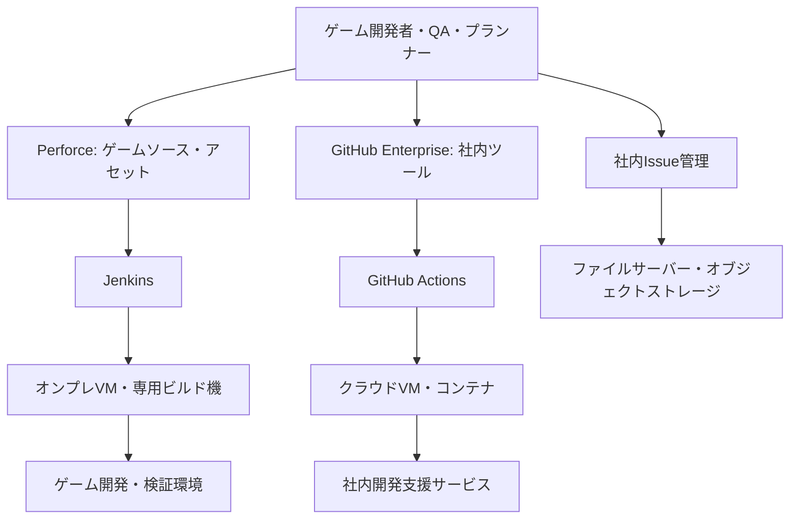

# 現行システム台帳

> すべて架空企業LAEのシナリオ上の前提であり、実在企業の内部情報ではない。人数・件数・時間・比率は実測値ではない。

## 6. 既存システム台帳（2026年10月時点）

| 領域 | [設定] 現行技術 | 既存構成が残っている理由 | 主な摩擦 |
|---|---|---|---|
| ゲームソース・アセット | Perforce中心 | 大規模アセットと変更管理の履歴 | 別システムとの連携 |
| 社内ツール開発 | GitHub Enterprise | 社内Webサービス開発の拡大 | PR・CI・運用窓口の分断 |
| CI/CD | Jenkins、GitHub Actions | チーム単位の漸進的な採用 | ジョブ実装・権限・ログ形式の差 |
| サーバー | オンプレVM、クラウドVM | 既存投資・特定ワークロード要件 | 構築手順の不均一性 |
| コンテナ実行 | 部分的なKubernetes | 比較的新しい支援サービスのために導入 | 共通運用基準が未統一 |
| IaC | 一部Terraform、手順書、シェル | 重要サービスを優先して移行 | 構成ドリフト、作業属人化 |
| 監視 | Prometheus、Grafana、従来型監視 | アプリ／インフラで異なる歴史 | 障害時の調査導線の分断 |
| 不具合管理 | 社内Issue管理システム | ゲーム制作向けの独自要件 | 動画・ログとの手作業紐づけ |
| 動画・ログ | ファイルサーバー、オブジェクトストレージ | サイズ・保存期間・アクセス制御が異なる | 閲覧権限と参照リンク管理 |

### 6.1 概念的な現行アーキテクチャ

**注意**：論理的な関係を示した図であり、ネットワーク境界、具体的な通信経路、各サービスの本番トポロジー、認証方式までは未決定。

## 未確定の現状情報

- 34サービスの分類、依存関係、利用者、運用責任者。
- 認証基盤、秘密情報の保持方法、環境別構成。
- 移行・改善方針は本資料では決めない。

